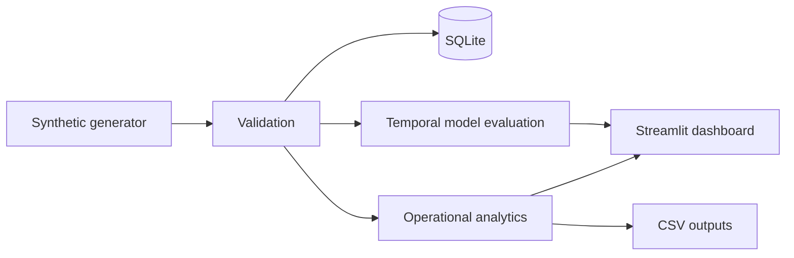

<div align="center">

# Project Sentinel

### Financial Transaction Intelligence & Risk Analytics

    

**Payment operations, settlement reconciliation and synthetic risk modelling on a reproducible dataset.**

[Data dictionary](data/README.md) · [SQL queries](sql/analysis.sql) · [Dashboard source](app.py) · [Tests](tests/test_sentinel.py)

</div>

---

## What this project does

I developed Sentinel to connect payment operations problems with quantitative analysis. It investigates provider approval and failure rates, processing latency, settlement discrepancies and the ability of machine learning models to distinguish simulated risk labels.

The default generator creates **100,000 fictional payment attempts** using a fixed random seed. This is a design target, not a claim that a dataset has already been published. No real transactions, customer identifiers or confidential employer information are used.

## Analytical workstreams

| Workstream | Implementation |
| --- | --- |
| Payment operations | Approval, failure and pending rates; attempted volume and daily activity |
| Provider benchmarking | Fictional PSP-level rates, median and 95th percentile latency |
| Settlement reconciliation | Expected versus actual settlement; signed and absolute discrepancies |
| Risk modelling | Random Forest classifier and Isolation Forest anomaly scoring |
| Evaluation | Chronological 80/20 holdout; ROC-AUC, average precision, precision, recall, F1 and confusion matrix |
| Business intelligence | Streamlit dashboard with provider and direction filters and CSV export |

## Architecture



## Quick start

Python 3.10+ recommended.

```bash
python -m venv .venv
# Activate your virtual environment.
pip install -r requirements.txt
python -m sentinel.pipeline --rows 100000 --seed 42
streamlit run app.py
```

The pipeline generates a local CSV and SQLite database, daily and provider summaries, reconciliation exceptions and model metrics. Generated data and outputs are excluded from Git. The dashboard independently generates the same default synthetic dataset.

## Repository structure

```text
sentinel/
  generate.py    Fictional transaction generator
  analysis.py    Validation and operational metrics
  model.py       Temporal model evaluation
  pipeline.py    Reproducible data and analysis workflow
sql/             Example analytical SQL
data/            Data dictionary and generated dataset location
outputs/         Generated research outputs
tests/           Automated validation
app.py           Streamlit dashboard
```

## Validation and limitations

```bash
python -m unittest discover -s tests -v
```

Approval and failure denominators are all attempted transactions, including pending attempts. Volumes are gross attempted KES, not revenue. Settlement amounts are deliberately simplified and do not model actual provider fee contracts. Model performance on synthetic labels measures simulation behavior only, not real fraud detection capability. No AML compliance conclusions or production decisions should be drawn from the simulated dataset.

## Project status

- [x] Implemented reproducible generator, SQL database pipeline and operational metrics
- [x] Implemented Random Forest and Isolation Forest evaluation
- [x] Implemented interactive dashboard and automated test definitions
- [x] Verify CI and execute full-size pipeline; publish downloadable research artifact
- [x] Add and execute exploratory notebook
- [ ] Host public dashboard

**Author:** [Samuel Ndungu Njoroge](https://github.com/samuel6183) · [LinkedIn](https://www.linkedin.com/in/samuel-ndungu-6800b8194/)

## Research notebook and generated results

[Open exploratory notebook](notebooks/sentinel_analysis.ipynb) · [Research workflow runs](https://github.com/samuel6183/project-sentinel/actions/workflows/research.yml)

The full research workflow runs the 100,000-row pipeline, executes the notebook, generates charts and an executive summary, and publishes downloadable workflow artifacts after successful completion. GitHub artifact downloads may require sign-in and expire after 90 days. No generated metrics are claimed until execution succeeds.

To generate the report locally after the pipeline:

```bash
python -m sentinel.report
```

For dashboard hosting on Streamlit Community Cloud, select this public repository, branch main and entry point app.py. Hosting requires an authorized Streamlit account; no hosted dashboard is claimed yet.

## Executed research results

Verified from the [successful research workflow](https://github.com/samuel6183/project-sentinel/actions/runs/45851888651), 26 November 2026 (100,000 synthetic attempts, seed 42).

| Metric | Observed result |
| --- | ---: |
| Transaction attempts | 100,000 |
| Gross attempted volume (KES) | 329,143,635.31 |
| Approval rate | 88.16% |
| Failure rate | 8.41% |
| Pending rate | 3.43% |
| Settlement exceptions | 684 |
| Absolute settlement discrepancy (KES) | 42,480.00 |

| Fictional provider | Attempts | Approval rate | Failure rate | P95 processing seconds | Absolute discrepancy (KES) |
| --- | ---: | ---: | ---: | ---: | ---: |
| PSP-A | 34,857 | 90.89% | 5.71% | 47.72 | 14,340.00 |
| PSP-B | 30,117 | 88.36% | 8.18% | 51.74 | 14,120.00 |
| PSP-C | 22,013 | 86.22% | 10.35% | 56.95 | 9,860.00 |
| PSP-D | 13,013 | 83.70% | 12.87% | 61.53 | 4,160.00 |

### Model evaluation

Chronological split: 80,000 training observations and 20,000 holdout observations; holdout synthetic label prevalence: 1.85%.

| Metric | Result |
| --- | ---: |
| Random Forest ROC-AUC | 0.6490 |
| Random Forest average precision | 0.0371 |
| Random Forest precision (threshold 0.5) | 0.0320 |
| Random Forest recall (threshold 0.5) | 0.4919 |
| Random Forest F1 (threshold 0.5) | 0.0601 |
| Isolation Forest average precision | 0.0334 |

The model shows limited discrimination and low precision. Threshold 0.5 produces many false positives. These are simulated outcomes, not real fraud findings or estimates of any actual provider's performance. Future work includes time-aware validation, probability calibration, and cost-sensitive threshold selection on separate validation data.

### Download research outputs

[Download the workflow artifact](https://github.com/samuel6183/project-sentinel/actions/runs/45851888651/artifacts/15133927853) (GitHub sign-in may be required; expires 24 February 2027). Contains the generated dataset, SQLite database, metrics, charts, executed notebook and report. Workflow tests, pipeline execution, report generation, notebook execution and artifact upload all succeeded. Metrics above were checked against execution logs, not independently recomputed from the artifact.
