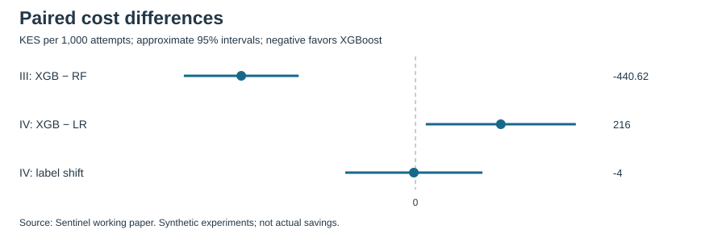
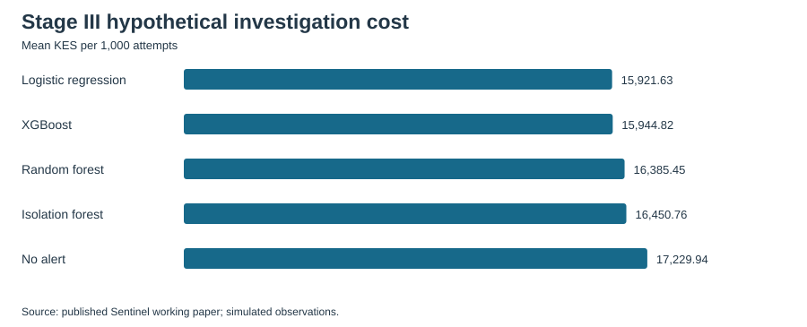

# Project Sentinel | Financial Transaction Risk Intelligence

**Independent simulation research · 31 distinct seeds · 3.1 million generated fictional attempts**

[Read the research paper](RESEARCH_PAPER.md) · [Full manuscript](research/Project_Sentinel_Research_Paper.txt) · [Explore Python notebook](notebooks/sentinel_analysis.ipynb) · [Citation](CITATION.cff)

## Abstract
A reproducible study of payment operations, reconciliation and cost-sensitive machine learning. Four sequential experiments compare Logistic Regression, Random Forest, XGBoost and Isolation Forest with chronological calibration, threshold selection and independent simulation replication.

## Key findings

| Experiment | Result |
|---|---|
| Operational baseline | 100,000 fictional attempts; 88.16% approved |
| Stage III: XGBoost minus Random Forest | −440.62 KES per 1,000; 95% CI [−585.90, −295.34] |
| Stage IV: XGBoost minus Logistic Regression | +216.00 KES per 1,000; 95% CI [26.16, 405.84] |
| Stage IV alternative label mechanism | −4.00 KES; 95% CI [−177.54, 169.54] |





The final original-mechanism comparison favors Logistic Regression on hypothetical cost, but recall remains low and the stress comparison is inconclusive. All data and costs are synthetic. No real fraud performance or realized savings are established.

## Explore and reproduce

[Experiment history and detailed results](research/experiment_history.md) · [V4 protocol](docs/confirmation_protocol.md) · [Successful V4 workflow](https://github.com/samuel6183/project-sentinel/actions/runs/45854541752)

```bash
pip install -r requirements.txt
python -m unittest discover -s tests -v
python -m sentinel.pipeline --rows 100000 --seed 42
streamlit run app.py
```

Public dashboard hosting is not confirmed. The online paper integrates the principal findings and plots; the original complete manuscript and protocols preserve the full research. Charts use reported simulation outcomes, not new execution. Independent working paper, not peer reviewed.

[Research portfolio](https://github.com/samuel6183)

## Verification status

[](https://github.com/samuel6183/project-sentinel/actions/workflows/test.yml)

[Latest successful validation inspected on 28 November 2026](https://github.com/samuel6183/project-sentinel/actions/runs/45922729501). This is evidence of automated workflow execution, not independent scientific replication or a verified public deployment.
