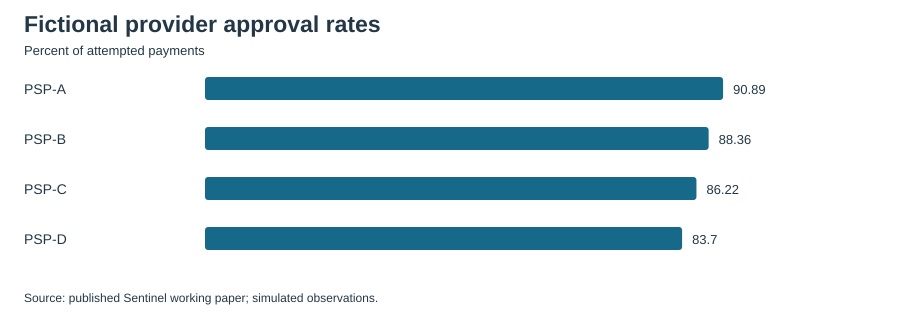
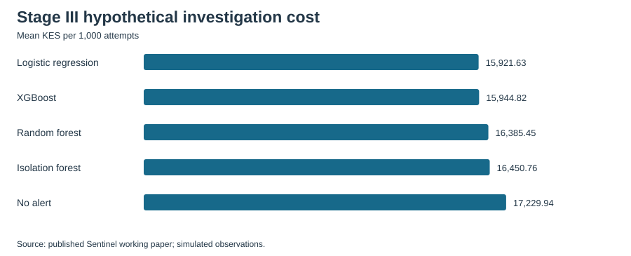
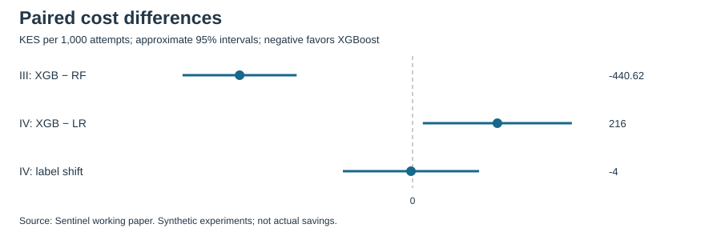

# Financial Transaction Risk Intelligence
## Cost-sensitive machine learning, temporal validation and robustness

Samuel Ndungu Njoroge · Independent simulation working paper · 26 November 2026

[Original manuscript transcription ](research/Project_Sentinel_Research_Paper.txt) · [Citation](CITATION.cff) · [Exploratory notebook](notebooks/sentinel_analysis.ipynb)

## Abstract

Project Sentinel compares Logistic Regression, Random Forest, XGBoost and Isolation Forest across four sequential synthetic experiments, using disjoint chronological fitting, calibration, threshold validation and testing. Thirty-one distinct seeds generate 3.1 million fictional attempts across datasets; the first dataset is reused in stages I and II. In ten-seed replication, XGBoost costs KES 440.62 less per 1,000 attempts than Random Forest (approximate 95% CI −585.90 to −295.34). In twenty fresh seeds, XGBoost costs KES 216.00 more than Logistic Regression (26.16 to 405.84) under the original mechanism, but the matched label-shift contrast is inconclusive. These are conditional simulation findings; no actual fraud data, production capability or realized savings are claimed.

## 1. Research problem and objectives

Rare-event monitoring requires balancing detection, review capacity and missed-positive costs. The project constructs a reproducible payment operations simulation, compares four model families under temporal separation, tests paired economic differences across new seeds, and evaluates calibration and attribution robustness. Operational metrics and experimental risk prediction are distinct workstreams.

## 2. Methodology

Each seed generates 100,000 fictional attempts, four fictional providers, payment directions, amounts, retries, account age, latency and settlements. Simulated labels depend on a prescribed logistic score, not real fraud outcomes. Pre-outcome features exclude settlement and transaction outcome. A separate logistic calibration maps model scores to probability estimates. Thresholds minimize hypothetical loss: KES 25 per reviewed alert plus KES 1,000 per missed positive, with 5% validation capacity under baseline assumptions. Seed-level paired t intervals average folds within each seed before inference.

| Stage | Design | Purpose |
|---|---|---|
| I | Seed 42, 80/20 chronological split | Operational baseline |
| II | Same seed, 60/10/10/20 split | Calibrated model comparison |
| III | Ten fresh seeds, four rolling folds each | Reliability and sensitivity |
| IV | Twenty fresh seeds, 70/10/10/10 split | Independent LR–XGBoost simulation comparison |

Detailed model parameters, label equations and sensitivity design are preserved in the [full manuscript ](research/Project_Sentinel_Research_Paper.txt) and [protocols](docs/confirmation_protocol.md).

## 3. Results

### Operational baseline (synthetic)

100,000 attempts; KES 329,143,635.31 gross attempted volume; 88.16% approved, 8.41% failed, 3.43% pending. 684 settlement exceptions and KES 42,480 absolute discrepancy. These are simulated outcomes.



### Model replication

| Model | Stage III cost per 1,000 (KES) | Average precision | Recall |
|---|---:|---:|---:|
| Logistic Regression | 15,921.63 | 3.97% | 14.15% |
| XGBoost | 15,944.82 | 3.71% | 13.82% |
| Random Forest | 16,385.45 | 3.33% | 11.25% |
| Isolation Forest | 16,450.76 | 3.12% | 10.50% |
| No alert | 17,229.94 | 1.72% | 0% |



The pre-specified XGBoost–Random Forest contrast supports lower simulated cost under the original mechanism; the alternative mechanism interval includes zero.

### Stage IV independent confirmation

| Mechanism | Model | Cost/1,000 (KES) | Recall | Brier |
|---|---|---:|---:|---:|
| Original | Logistic Regression | 16,303.29 | 14.38% | .017236 |
| Original | XGBoost | 16,519.29 | 12.73% | .017241 |
| Stress | Logistic Regression | 23,673.26 | 8.23% | .023946 |
| Stress | XGBoost | 23,669.25 | 7.96% | .023931 |



The original-mechanism contrast (XGBoost minus LR) is +216.00 KES per 1,000 (95% CI +26.16 to +405.84). Under alternative labels it is −4.00 (−177.54 to +169.54). The stress result is inconclusive, not formal equivalence. Calibration reduces Brier scores; recent transaction count has the largest mean absolute raw-log-odds attribution in both models. PSI outputs are available in the workflow artifact; no unsupported drift claim is made.

## 4. Discussion and conclusion

The ranking changes across model comparisons and mechanisms. The simplest model has a conditional cost advantage in the final original-mechanism experiment, but recall is low. Simulation draws do not constitute external validation across institutions. The hypothetical loss function omits recovery probabilities, heterogeneous exposure and staffing constraints. No model should be used for real transaction decisions on this evidence alone.

## 5. Reproduction

```bash
pip install -r requirements.txt
python -m unittest discover -s tests -v
python -m sentinel.pipeline --rows 100000 --seed 42
python -m sentinel.advanced --rows 100000 --seed 42
python -m sentinel.reliability --rows 100000
python -m sentinel.confirmation --rows 100000
```

[Stage IV successful execution](https://github.com/samuel6183/project-sentinel/actions/runs/45854541752) · [Research artifacts](https://github.com/samuel6183/project-sentinel/actions/runs/45854541752/artifacts/15134992738)

The charts in this online summary are derived from the published manuscript's reported results, not a new model run. The original manuscript contains the complete literature review, hypotheses, cost scenarios, detailed methods and references. Not peer reviewed. AI-assisted research implementation and presentation; independent author review is required.
