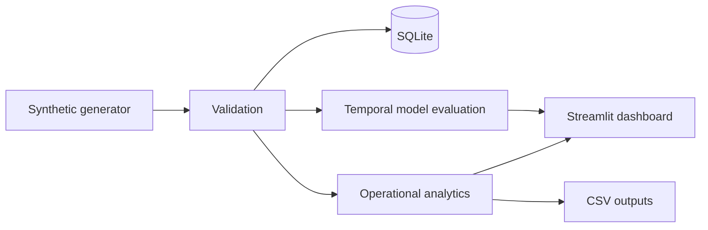

<div align="center">

# Project Sentinel

### Financial Transaction Intelligence & Risk Analytics

    

**Payment operations, settlement reconciliation and synthetic risk modelling on a reproducible dataset.**

[Data dictionary](data/README.md) · [SQL queries](sql/analysis.sql) · [Dashboard source](app.py) · [Tests](tests/test_sentinel.py)

</div>

---

## What this project does

I developed Sentinel to connect payment operations problems with quantitative analysis. It investigates provider approval and failure rates, processing latency, settlement discrepancies and the ability of machine learning models to distinguish simulated risk labels.

The default generator creates **100,000 fictional payment attempts** using a fixed random seed. This is a design target, not a claim that a dataset has already been published. No real transactions, customer identifiers or confidential employer information are used.

## Analytical workstreams

| Workstream | Implementation |
| --- | --- |
| Payment operations | Approval, failure and pending rates; attempted volume and daily activity |
| Provider benchmarking | Fictional PSP-level rates, median and 95th percentile latency |
| Settlement reconciliation | Expected versus actual settlement; signed and absolute discrepancies |
| Risk modelling | Random Forest classifier and Isolation Forest anomaly scoring |
| Evaluation | Chronological 80/20 holdout; ROC-AUC, average precision, precision, recall, F1 and confusion matrix |
| Business intelligence | Streamlit dashboard with provider and direction filters and CSV export |

## Architecture



## Quick start

Python 3.10+ recommended.

```bash
python -m venv .venv
# Activate your virtual environment.
pip install -r requirements.txt
python -m sentinel.pipeline --rows 100000 --seed 42
streamlit run app.py
```

The pipeline generates a local CSV and SQLite database, daily and provider summaries, reconciliation exceptions and model metrics. Generated data and outputs are excluded from Git. The dashboard independently generates the same default synthetic dataset.

## Repository structure

```text
sentinel/
  generate.py    Fictional transaction generator
  analysis.py    Validation and operational metrics
  model.py       Temporal model evaluation
  pipeline.py    Reproducible data and analysis workflow
sql/             Example analytical SQL
data/            Data dictionary and generated dataset location
outputs/         Generated research outputs
tests/           Automated validation
app.py           Streamlit dashboard
```

## Validation and limitations

```bash
python -m unittest discover -s tests -v
```

Approval and failure denominators are all attempted transactions, including pending attempts. Volumes are gross attempted KES, not revenue. Settlement amounts are deliberately simplified and do not model actual provider fee contracts. Model performance on synthetic labels measures simulation behavior only, not real fraud detection capability. No AML compliance conclusions or production decisions should be drawn from the simulated dataset.

## Project status

- [x] Implemented reproducible generator, SQL database pipeline and operational metrics
- [x] Implemented Random Forest and Isolation Forest evaluation
- [x] Implemented interactive dashboard and automated test definitions
- [x] Verify CI and execute full-size pipeline; publish downloadable research artifact
- [x] Add and execute exploratory notebook
- [ ] Host public dashboard

**Author:** [Samuel Ndungu Njoroge](https://github.com/samuel6183) · [LinkedIn](https://www.linkedin.com/in/samuel-ndungu-6800b8194/)

## Research notebook and generated results

[Open exploratory notebook](notebooks/sentinel_analysis.ipynb) · [Research workflow runs](https://github.com/samuel6183/project-sentinel/actions/workflows/research.yml)

The full research workflow runs the 100,000-row pipeline, executes the notebook, generates charts and an executive summary, and publishes downloadable workflow artifacts after successful completion. GitHub artifact downloads may require sign-in and expire after 90 days. No generated metrics are claimed until execution succeeds.

To generate the report locally after the pipeline:

```bash
python -m sentinel.report
```

For dashboard hosting on Streamlit Community Cloud, select this public repository, branch main and entry point app.py. Hosting requires an authorized Streamlit account; no hosted dashboard is claimed yet.

## Executed research results

Verified from the [successful research workflow](https://github.com/samuel6183/project-sentinel/actions/runs/45851888651), 26 November 2026 (100,000 synthetic attempts, seed 42).

| Metric | Observed result |
| --- | ---: |
| Transaction attempts | 100,000 |
| Gross attempted volume (KES) | 329,143,635.31 |
| Approval rate | 88.16% |
| Failure rate | 8.41% |
| Pending rate | 3.43% |
| Settlement exceptions | 684 |
| Absolute settlement discrepancy (KES) | 42,480.00 |

| Fictional provider | Attempts | Approval rate | Failure rate | P95 processing seconds | Absolute discrepancy (KES) |
| --- | ---: | ---: | ---: | ---: | ---: |
| PSP-A | 34,857 | 90.89% | 5.71% | 47.72 | 14,340.00 |
| PSP-B | 30,117 | 88.36% | 8.18% | 51.74 | 14,120.00 |
| PSP-C | 22,013 | 86.22% | 10.35% | 56.95 | 9,860.00 |
| PSP-D | 13,013 | 83.70% | 12.87% | 61.53 | 4,160.00 |

### Model evaluation

Chronological split: 80,000 training observations and 20,000 holdout observations; holdout synthetic label prevalence: 1.85%.

| Metric | Result |
| --- | ---: |
| Random Forest ROC-AUC | 0.6490 |
| Random Forest average precision | 0.0371 |
| Random Forest precision (threshold 0.5) | 0.0320 |
| Random Forest recall (threshold 0.5) | 0.4919 |
| Random Forest F1 (threshold 0.5) | 0.0601 |
| Isolation Forest average precision | 0.0334 |

The model shows limited discrimination and low precision. Threshold 0.5 produces many false positives. These are simulated outcomes, not real fraud findings or estimates of any actual provider's performance. Future work includes time-aware validation, probability calibration, and cost-sensitive threshold selection on separate validation data.

### Download research outputs

[Download the workflow artifact](https://github.com/samuel6183/project-sentinel/actions/runs/45851888651/artifacts/15133927853) (GitHub sign-in may be required; expires 24 February 2027). Contains the generated dataset, SQLite database, metrics, charts, executed notebook and report. Workflow tests, pipeline execution, report generation, notebook execution and artifact upload all succeeded. Metrics above were checked against execution logs, not independently recomputed from the artifact.

## Advanced machine learning methodology (v2)

[Read the evaluation protocol](docs/model_methodology.md). Four model families (Logistic Regression, Random Forest, XGBoost and Isolation Forest) are evaluated with distinct chronological training, calibration, threshold-validation and final-test partitions. The protocol includes engineered pre-outcome features, calibrated risk scores, a hypothetical review-cost objective, an alert-capacity constraint and a no-alert baseline. The earlier results above remain the historical v1 benchmark; new metrics will be reported only after successful execution.

```bash
python -m sentinel.advanced --rows 100000 --seed 42
```

Outputs: `outputs/advanced_model_comparison.csv` and `outputs/advanced_model_protocol.json`. This is a simulated experiment, not validated fraud detection.

### V2 executed results — 26 November 2026

[Successful research run](https://github.com/samuel6183/project-sentinel/actions/runs/45852666019) · [Download research artifact](https://github.com/samuel6183/project-sentinel/actions/runs/45852666019/artifacts/15133963633) (expires 24 February 2027; sign-in may be required).

100,000 synthetic attempts, seed 42; chronological train/calibration/validation/test partitions: 60,000/10,000/10,000/20,000. Test positives: 370 (1.85%). Review cost KES 25, missed-positive cost KES 1,000, validation alert capacity 5%. These costs are assumptions.

| Model | Validation cost (KES) | Test ROC-AUC | Test average precision | Test precision | Test recall | Test alerts | TP | FP | FN | Test cost (KES) |
| --- | ---: | ---: | ---: | ---: | ---: | ---: | ---: | ---: | ---: | ---: |
| Logistic regression | 170,050 | .664757 | .041607 | .072650 | .045946 | 234 | 17 | 217 | 353 | 358,850 |
| Random forest | 167,875 | .645212 | .035221 | .051107 | .081081 | 587 | 30 | 557 | 340 | 354,675 |
| XGBoost | 169,250 | .667769 | .039567 | .056604 | .129730 | 848 | 48 | 800 | 322 | 343,200 |
| Isolation forest | 170,575 | .605237 | .033615 | .041575 | .102703 | 914 | 38 | 876 | 332 | 354,850 |
| No-alert baseline | 175,000 | .500000 | .018500 | 0 | 0 | 0 | 0 | 0 | 370 | 370,000 |

Random Forest is the validation-selected champion. XGBoost has the lowest observed test cost (KES 26,800 or 7.24% below the no-alert baseline), but selecting it on the test set would introduce selection bias. It is a candidate for a new independent experiment, not a replacement champion yet. Logistic regression has the highest average precision. All models have low precision and recall at their selected thresholds. The validation champion reduces hypothetical test cost by KES 15,325 (4.14%). No production fraud performance or actual financial savings are established.

Workflow tests, advanced comparison, notebook execution and artifact upload succeeded. Metrics were checked against execution logs; costs and confusion counts reconcile arithmetically, but the dataset was not independently rerun or audited. The previous experiment used the same synthetic seed, so this is exploratory rather than independent external validation. Next: independent seed holdout, rolling-origin validation, uncertainty intervals and cost sensitivity.

## V3 reliability replication

[Pre-specified research protocol](docs/reliability_protocol.md) · [Reliability workflow](https://github.com/samuel6183/project-sentinel/actions/workflows/reliability.yml)

Ten new simulation seeds, four expanding chronological folds per seed, paired model cost comparisons, approximate seed-level uncertainty intervals, seven pre-specified cost/capacity scenarios, and a separate held-out label-mechanism stress test. Earlier V1/V2 results are retained. V3 results are documented below; no universal superiority claim has been made.

```bash
python -m sentinel.reliability --rows 100000
```

### Reliability dashboard

The Streamlit app now supports importing the V3 seed summary and paired-cost contrast CSVs from a completed reliability artifact (or reading local outputs). It displays scenario-specific savings with uncertainty intervals, model metrics and paired cost comparisons. No placeholder V3 results are presented. Run `streamlit run app.py` locally; hosted deployment remains unconfirmed.

### V3 executed reliability results — 26 November 2026

[Successful workflow](https://github.com/samuel6183/project-sentinel/actions/runs/45853644658) · [Download reliability outputs](https://github.com/samuel6183/project-sentinel/actions/runs/45853644658/artifacts/15134189936) (expires 24 February 2027; GitHub sign-in may be required).

Ten fresh seeds, 100,000 generated transactions per seed, four rolling test windows per seed. Baseline: KES 25 review cost, KES 1,000 missed-positive cost, 5% validation capacity. Results are means across seed-level fold averages, not a single million-row test set.

| Model | Cost per 1,000 (KES) | Savings per 1,000 (KES) | 95% savings interval | Average precision | Recall | Alert rate |
| --- | ---: | ---: | --- | ---: | ---: | ---: |
| Logistic regression | 15,921.63 | 1,308.31 | [1,171.92, 1,444.70] | 3.97% | 14.15% | 4.53% |
| XGBoost | 15,944.82 | 1,285.12 | [1,064.72, 1,505.52] | 3.71% | 13.82% | 4.35% |
| Random forest | 16,385.45 | 844.50 | [681.40, 1,007.59] | 3.33% | 11.25% | 4.34% |
| Isolation forest | 16,450.76 | 779.19 | [639.75, 918.63] | 3.12% | 10.50% | 4.13% |
| No-alert baseline | 17,229.94 | 0 | [0, 0] | 1.72% | 0% | 0% |

Primary pre-specified paired contrast (XGBoost minus Random Forest, KES per 1,000): **-440.62**, approximate 95% CI [-585.90, -295.34]. The simulated baseline cost advantage replicates. Under the alternative held-out label mechanism the contrast is -145.75, CI [-465.15, 173.66]; inconclusive. The stress comparison uses only the final fold per seed. Do not compare stress and all-fold averages as a causal drift effect.

| Scenario | Same-mechanism paired difference | 95% interval | Stress paired difference | 95% interval |
| --- | ---: | --- | ---: | --- |
| Baseline | -440.62 | [-585.90, -295.34] | -145.75 | [-465.15, 173.66] |
| Review 10 | -440.10 | [-593.51, -286.69] | -87.30 | [-395.83, 221.22] |
| Review 50 | -163.87 | [-303.46, -24.28] | 5.00 | [-231.19, 241.19] |
| Miss 500 | -81.94 | [-151.73, -12.14] | 2.50 | [-115.59, 120.59] |
| Miss 2,000 | -890.87 | [-1,212.15, -569.59] | -136.50 | [-789.01, 516.00] |
| Capacity 2% | -129.75 | [-260.36, 0.85] | -13.00 | [-147.52, 121.52] |
| Capacity 10% | -433.43 | [-680.94, -185.92] | -340.49 | [-694.19, 13.21] |

Sensitivity intervals are exploratory and not adjusted for multiplicity. Logistic regression had the lowest observed average baseline cost, but its 23.19 KES difference from XGBoost has not been tested with a paired interval. No global champion is promoted. All models miss most simulated positives; no external or production validation is established. Results transcribed from successful workflow logs; underlying CSVs have not been independently recomputed. For stronger evidence, use fresh simulation seeds with a pre-specified logistic-regression versus XGBoost contrast and evaluate matched final-fold conditions, followed by legitimate external data if available.

## V4 independent confirmation and explainability

[Pre-specified V4 protocol](docs/confirmation_protocol.md) · [Confirmation workflow](https://github.com/samuel6183/project-sentinel/actions/workflows/confirmation.yml)

Twenty new independent seeds (2 million generated synthetic attempts), fixed final chronological test windows, paired XGBoost versus logistic regression cost comparison, matched label-shift stress test, calibration curves, raw-log-odds feature attributions and PSI drift diagnostics. Execution completed; see results and manuscript below. Prior V1–V3 results remain intact.

```bash
python -m sentinel.confirmation --rows 100000
```

### V4 confirmed results

The [V4 workflow](https://github.com/samuel6183/project-sentinel/actions/runs/45854541752) completed successfully. Across 20 fresh seeds, XGBoost minus Logistic Regression hypothetical cost per 1,000 attempts was KES 216.00 (95% CI 26.16–405.84) under the original mechanism and −KES 4.00 (95% CI −177.54–169.54) under matched label shift. These are conditional simulation findings, not production evidence. [V4 artifact](https://github.com/samuel6183/project-sentinel/actions/runs/45854541752/artifacts/15134992738).

## Research publication

[Read the full working paper and suggested citation ](research/README.md). Published as a plain-text transcription of the nine-page manuscript, version 1.0, 26 November 2026. Not peer reviewed; no DOI assigned. The original formatted PDF remains to be uploaded.
